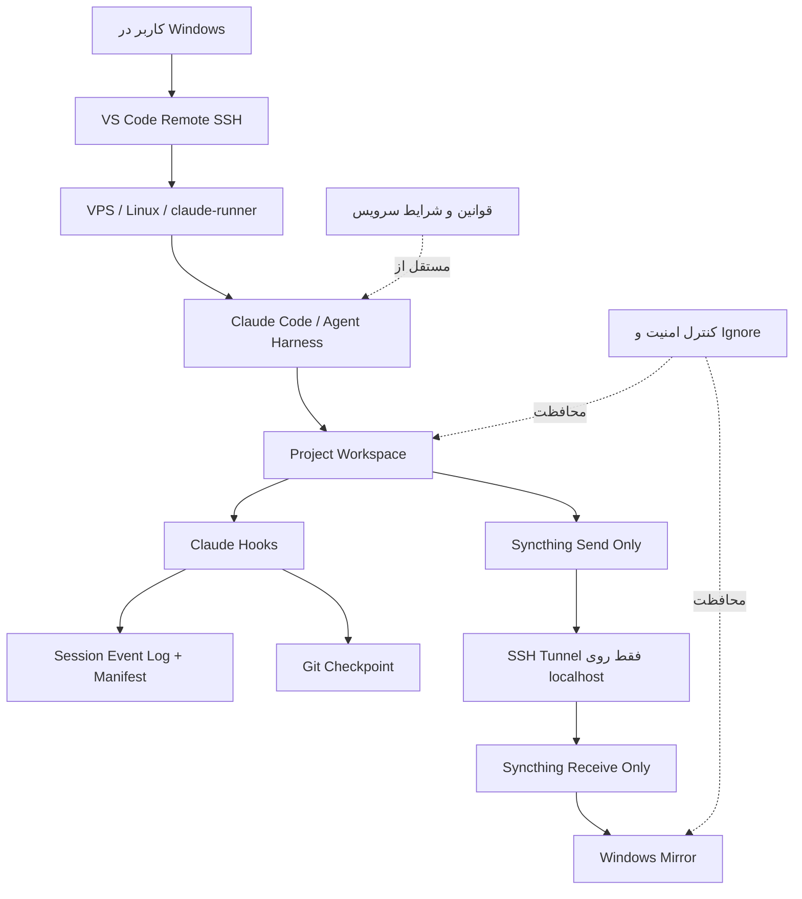
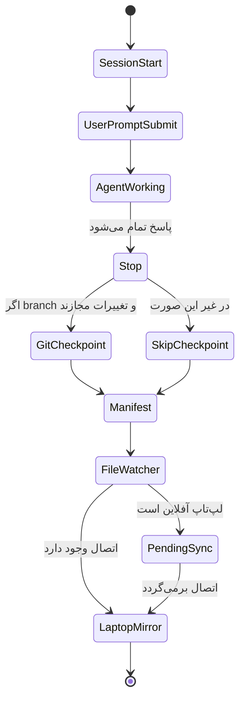
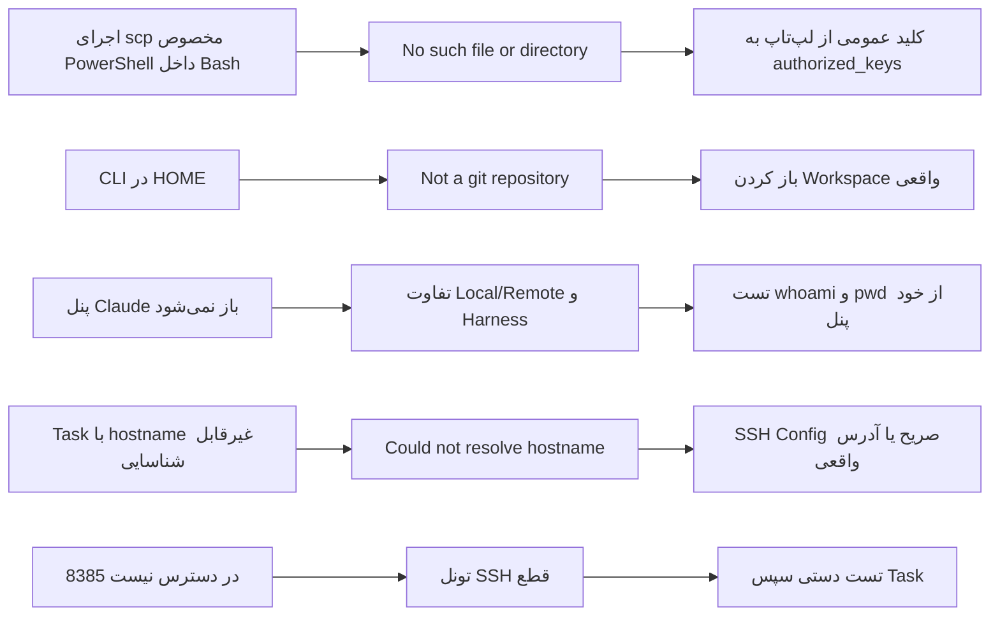

# نقشه دانش AWTT Privacy

[صفحه اصلی](../README.md) ← این صفحه برای پیدا کردن رابطه اجزا و مسیر مطالعه است.

## نقشه مفهومی

### مسیرها و مسئولیت‌ها

| مفهوم | مسئولیت | کجا اجرا می‌شود؟ | منبع دانش |
|---|---|---|---|
| Remote SSH | بردن اجرای ترمینال/افزونه Workspace به سرور | VS Code ↔ VPS | [معماری](01-architecture.md) |
| کاربر محدود | جداسازی فعالیت ایجنت از root و سرویس‌های دیگر | VPS | [نصب](02-step-by-step.md) |
| Workspace | محل اصلی پروژه و خروجی‌های ایجنت | VPS | [نصب](02-step-by-step.md) |
| SessionStart | ثبت شروع یا ازسرگیری سشن | Claude Hook | [کد](../examples/project-template/.claude/hooks/session.py) |
| UserPromptSubmit | ثبت رویداد پرامپت بدون ذخیره متن | Claude Hook | [کد](../examples/project-template/.claude/hooks/session.py) |
| Stop | تلاش برای Checkpoint و ثبت Manifest پس از پاسخ | Claude Hook | [کد](../examples/project-template/.claude/hooks/session.py) |
| Git | تاریخچه قابل بازیابی تغییرات گزینش‌شده | VPS | [معماری](01-architecture.md) |
| Syncthing | Mirror فایل‌ها، نه انتقال تاریخچه Git | VPS → Laptop | [نصب](02-step-by-step.md) |
| SSH Tunnel | جلوگیری از باز شدن عمومی پورت‌های Syncthing | Windows ↔ VPS | [نصب](02-step-by-step.md) |
| Privacy | کم‌کردن داده‌های ناخواسته و سطح حمله | هر دو سمت | [امنیت](04-security.md) |

## مدل جریان رویداد

**استثنا:** قطع ناگهانی فرایند یا خطای اجرای ایجنت الزاماً Stop را اجرا نمی‌کند. Syncthing مستقل از Hook تغییرات فایل را تشخیص می‌دهد، اما Manifest ممکن است آخرین نوبت را «تکمیل‌شده» نشان ندهد.

## دانش مبتنی بر تجربه و اسناد

| شناسه | مشاهده / تصمیم | نوع شواهد |
|---|---|---|
| OBS-01 | اجرای CLI زیر کاربر محدود و اجرای `whoami` و `git status` روی VPS موفق شد | تأیید کاربر در اجرای واقعی |
| OBS-02 | پنل VS Code Remote نهایتاً به VPS متصل و اجرای Agent در پوشه پروژه تأیید شد | تأیید کاربر |
| OBS-03 | Hookها و Checkpoint در پروژه آزمایشی اجرا شدند | تأیید کاربر؛ فایل واقعی سرور منتشر نشده |
| OBS-04 | اتصال دو دستگاه Syncthing و دریافت `mirror-test.txt` روی Windows موفق بود | تأیید کاربر |
| OBS-05 | بازیابی خودکار SSH Tunnel پس از اصلاح نام میزبان موفق شد | تأیید کاربر |
| DOC-01 | Remote SSH افزونه‌های Workspace را روی SSH host اجرا می‌کند | [VS Code](https://code.visualstudio.com/docs/remote/ssh) |
| DOC-02 | Stop و SessionStart و UserPromptSubmit رویدادهای رسمی هستند | [Claude Hooks](https://code.claude.com/docs/en/hooks) |
| DOC-03 | Syncthing از Send Only و Receive Only پشتیبانی می‌کند | [Syncthing](https://docs.syncthing.net/users/foldertypes.html) |
| DOC-04 | SSH Forward و Reverse روی localhost قابل استفاده است | [Syncthing SSH tunnel](https://docs.syncthing.net/users/tunneling.html) |

## مسائل رخ‌داده و رابطه علت و رفع خطا

برای دستورات رفع خطا: [دفترچه عیب‌یابی](03-troubleshooting.md).

## اصطلاحات ساده

- **VPS / Source of Truth:** سروری که نسخه اصلی کار آنجاست.
- **Mirror:** کپی فایل روی لپ‌تاپ؛ لزوماً بکاپ مستقل نیست.
- **SSH Host Alias:** نام دلخواه در فایل `.ssh/config` که بدون تعریف به‌عنوان DNS واقعی کار نمی‌کند.
- **Hook:** اسکریپتی که در لحظه یک رویداد مشخص اجرا می‌شود.
- **Session ID:** شناسه نشست گفتگو، متفاوت از Branch و نام پروژه.
- **Manifest:** فهرست مختصر وضعیت یک مرحله و خروجی‌های آن.
- **Checkpoint:** ثبت گزینش‌شده تغییرات در Git.
- **Send Only / Receive Only:** سیاست انتقال یک‌طرفه پوشه در Syncthing.
- **Loopback:** آدرس `127.0.0.1` قابل دسترسی فقط از همان دستگاه.
- **Harness:** محیطی که اجرای ایجنت و ابزارها را مدیریت می‌کند؛ Claude Code مستقل با Chat/Copilot VS Code الزاماً یکسان نیست.

## ترتیب مطالعه

۱. [معماری](01-architecture.md) → ۲. [امنیت](04-security.md) → ۳. [نصب](02-step-by-step.md) → ۴. [تست](05-test-plan.md) → ۵. [عیب‌یابی](03-troubleshooting.md).
